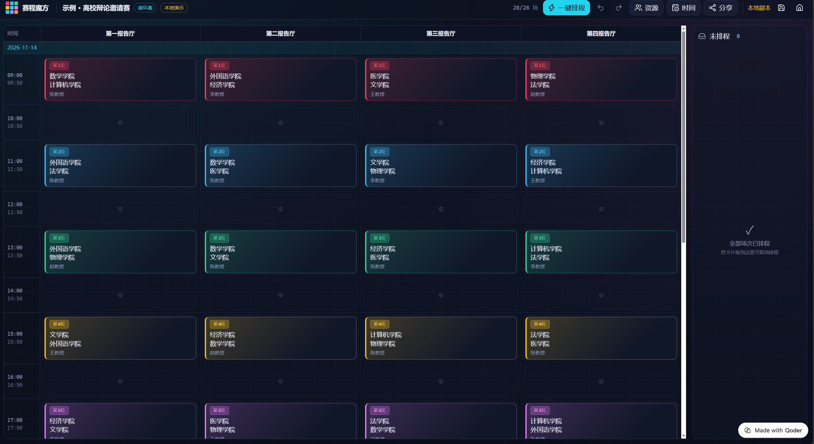
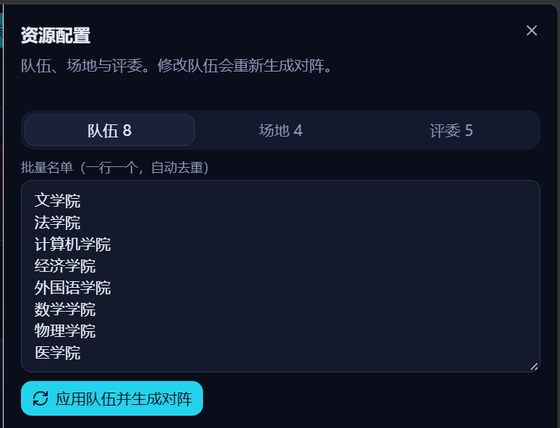
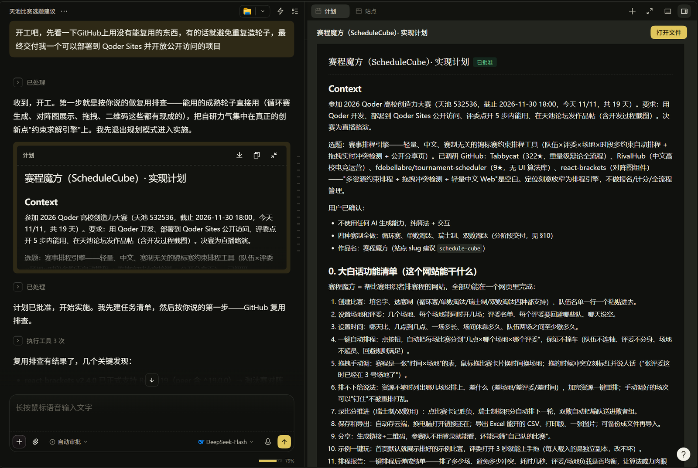

# 赛程魔方

给高校赛事组织者（院系、学生会、社团）用的中文排程工具：填好队伍、场地、评委和时间，点一次「一键排程」，几百场比赛自动排入、零冲突，还能随手拖改。

在线体验：https://schedule-cube-95d4bo3wm4y.qoder.zone

免注册、免登录。打开就是一场已经排好的示例赛（8 支队伍 / 4 块场地 / 5 位评委 / 2 天 / 28 场），每位访客拿到独立副本，改动只影响自己的浏览器。



*示例赛看板：4 块场地 × 2 个比赛日，28 场比赛全部排入，硬冲突 0。*

## 功能

- **自动排程**：8 条硬约束一次求解——场地容量、队伍不撞场、队伍休息、队伍不可用日期、评委可用、评委回避、评委不撞场、轮次与晋级次序。支持循环赛、单败淘汰、瑞士制、双败淘汰。
- **实时冲突检测**：手动拖动比赛卡时，违反约束立即标红并说明原因，与自动排程共用同一套判定口径。
- **可解释的排程报告**：排入多少场、冲突几处、评委与场地负载、未排场次卡在哪个约束，都翻译成人话。
- **发得出去**：Excel CSV（中文不乱码）、赛程图片、打印版、JSON 备份，四种导出都在浏览器内完成。
- **分享链接**：通过 Qoder Sites Function 保存赛程并生成只读分享页；编辑权限由 editToken 控制。



*资源配置：队伍整列粘贴、自动去重；场地和评委分开设置。*

## 技术栈

- React 19 + TypeScript + Vite 8 + Tailwind CSS 4
- Zustand 状态管理，dnd-kit 拖拽，roundrobin / swiss-pairing 赛制编排
- `engine/` 是纯 TypeScript 排程与冲突判定内核，可脱离界面单独测试
- `functions/` 是 Qoder Sites Function（database，无 Storage），负责分享页的保存与读取
- `dist/` 为构建产物，部署时上传 `dist/` 与 `functions/`

## 本地运行

需要 Node.js `^22.13.0 || >=24.0.0`。

```sh
npm ci
npm run dev      # 启动前端与本地后端，打开终端输出的 loopback 地址
npm test         # 35 项引擎与路由测试
npm run build    # 类型检查 + 构建到 dist/
```

本地开发默认使用内存数据与合成账号，不连接真实数据库；访问同源 `/__local/` 控制台可切换身份与故障场景。生产构建不包含该控制台。

## 目录

```text
engine/      排程、冲突、赛制与约束判定
components/  看板、拖拽、资源与约束面板、报告与分享
pages/       首页、创建向导、编辑页、分享页
store/       赛程状态与命令
functions/   Qoder Sites Function：保存、读取、分享
lib/         API、导出、存储与界面工具
dev/         本地开发用的内存后端与测试控制台
scripts/     构建与 Node 版本检查
```

## 用 Qoder 开发

项目在 Qoder 中完成：先出实现计划，再按计划实现排程引擎、看板、分享与测试。



## 说明

- 示例中的队伍、评委、场地均为合成数据。
- 排程结果取决于录入的约束与赛制，不替代赛事主办方的最终裁定。
- 第三方模板来源与许可见 [PROVENANCE.md](./PROVENANCE.md)。
